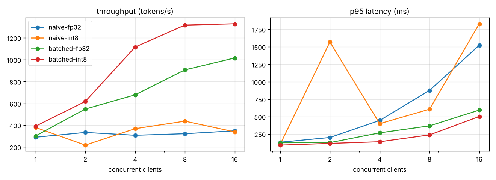

# llm-serving-bench

A CPU LLM inference server with **dynamic request batching** and a **KV-cache** generation loop, plus a load generator that measures p50/p95 latency, tokens/s and throughput. It compares naive and batched serving, fp32 and int8 dynamic quantisation.

## Setup
```bash
cd ml/llm-serving-bench
python3.12 -m venv .venv && . .venv/bin/activate
pip install torch==2.15.0 --index-url https://download.pytorch.org/whl/cpu
pip install -r requirements.txt
```

## Usage
```bash
python -m pytest -q                         # 12 tests, ~15 s (includes a quick end-to-end benchmark)
LLM_MAX_BATCH=16 LLM_QUANT=int8 uvicorn llmserve.server:app --port 8000
curl -X POST localhost:8000/generate -H 'content-type: application/json' -d '{"prompt":"Once upon a time","max_new_tokens":32}'
curl localhost:8000/stats                   # batch-size histogram
python bench.py                             # full benchmark, ~1 min, writes results/
```
Server settings (env vars): `LLM_MAX_BATCH` (1 = naive, one request at a time), `LLM_MAX_WAIT_MS` (batching window, default 5), `LLM_QUANT` (`none` | `int8`).

## Architecture
```
HTTP /generate ─► asyncio.Queue ─► Batcher.run(): take 1st request, wait ≤ max_wait_ms for up to max_batch
                                      │
                       one dedicated model thread ─► generate(batch): left-pad + key mask
                                      │                 prefill once ─► decode loop, 1 token/step, K/V appended
                       futures resolved per request ◄──┘ (each request truncated to its own max_new_tokens)
```
- `llmserve/model.py`: a GPT-2-style decoder (6 layers, d=512, 8 heads, byte vocab, 19.4 M params). It does batched greedy generation with a KV cache. Left padding plus a key mask lets prompts of different lengths share a batch; positions come from the mask, so padding does not shift them. `quantize()` = `torch.ao.quantization.quantize_dynamic` on every `nn.Linear`.
- `llmserve/batcher.py`: dynamic batching, a standard library asyncio queue plus futures. Errors fail the whole batch, and no caller hangs.
- `llmserve/server.py`: FastAPI `/generate`, `/stats`, `/health`.
- `bench.py`: one server subprocess per config. Closed-loop clients at 1/2/4/8/16 concurrency, 32 new tokens per request, `max(20, 3×clients)` requests per level after a warm-up at full concurrency. p95 uses the inclusive quantile method, so it never extrapolates past the slowest request.

The tests check the important properties directly:
- KV-cache output is identical to full recomputation.
- A padded batch gives the same tokens as one-by-one generation (in float64).
- The batcher groups and routes requests correctly.

**Model weights.** Hugging Face downloads are blocked in this sandbox, so the model is randomly initialised with seed 0 instead of using distilgpt2. Serving cost depends on the shapes (layers, width, sequence length), not on the weight values, so latency and throughput carry over. Text quality is meaningless and not measured.

## Results (4 vCPU Xeon @ 2.1 GHz, torch 2.15 CPU, 32 new tokens/request)


| config | clients | p50 ms | p95 ms | tokens/s | mean batch |
|---|---|---|---|---|---|
| naive-fp32 | 1 | 107 | 132 | 289 | 1.0 |
| naive-fp32 | 16 | 1433 | 1522 | 348 | 1.0 |
| naive-int8 | 16 | 1304 | 1829 | 339 | 1.0 |
| batched-fp32 | 4 | 176 | 267 | 679 | 4.0 |
| batched-fp32 | 16 | 484 | 594 | 1016 | 8.0 |
| batched-int8 | 4 | 115 | 140 | 1115 | 4.0 |
| batched-int8 | 16 | 361 | 502 | **1329** | 8.0 |

Full table: [results/results.md](results/results.md).

| model | size | greedy-token agreement with fp32 |
|---|---|---|
| fp32 | 77.8 MB | 100 % |
| int8 dynamic | 20.8 MB (3.7× smaller) | 73 % of tokens, 100 % of first tokens |

Findings:
- **Batching is the main lever.** At 16 clients, batched fp32 gives 2.9× the throughput of naive serving and cuts p95 latency 2.6×. Naive throughput stays flat around 300-350 tokens/s and latency grows linearly with the queue.
- **int8 adds 1.3-1.6× on top of batching.** Batched int8 vs naive fp32 at 16 clients is 3.8× the tokens/s.
- **int8 changes outputs.** 27 % of greedy tokens differ from fp32. On this random-weight model the logits are nearly flat, so small errors flip the argmax. A trained model has peaked logits and usually agrees much more, but quality must be measured on the real model before int8 ships.
- **Mean batch is 8, not 16, at 16 clients.** The closed-loop clients split into two cohorts that alternate. A longer `LLM_MAX_WAIT_MS` fills batches but adds latency to every request; continuous batching fixes this properly.
- **Debugging note.** The first benchmark showed naive batch-1 latency 2× slower than batched batch-1. The cause was torch work running on several threads (`asyncio.to_thread` pool plus the main thread): each thread gets its own OpenMP pool, and the pools fight for the 4 cores. The fix runs all torch work, including model construction, on one dedicated thread. That halved latency.

Numbers vary roughly ±15 % between runs on this shared VM. One outlier in the committed run: naive-int8 at 2 clients has p95 = 1569 ms against p50 = 158 ms. That is a single slow request, most likely from other work on the shared CPUs during the run. It is kept as measured.

## Not done (time box)
Continuous (iteration-level) batching, sampling (temperature/top-p), streaming responses, paged KV memory, a real pretrained checkpoint.
